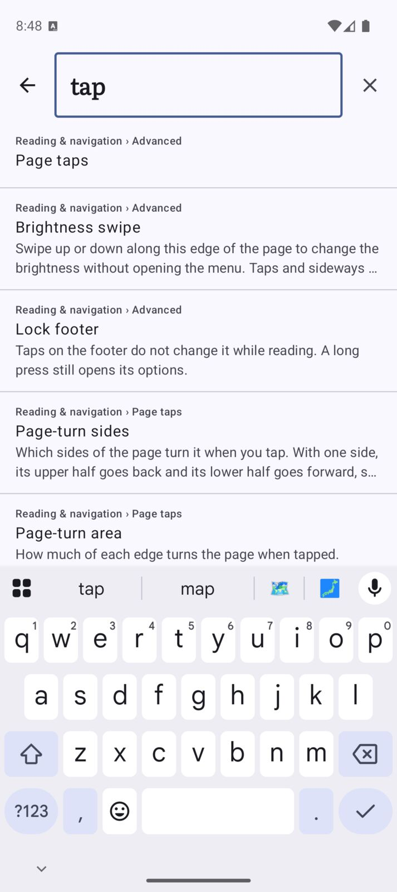

This release adds more control over the reading screen and new ways to arrange the library. The Companion is also easier to use when catching up on a book.

### Reading
- Choose Auto, Portrait or Landscape while a book is open; the rest of the app still follows your phone’s rotation. Find the setting in the reader’s Advanced sheet or Reading & navigation settings. ([#443](https://github.com/chmouel/liseur/pull/443))

- Search settings by name to jump to an option, including ones inside collapsed Advanced groups. ([#439](https://github.com/chmouel/liseur/pull/439))

### Library
- Choose Classic, Home, Shelves or List, with previews showing your own book covers. ([#441](https://github.com/chmouel/liseur/pull/441))

- Customize Shelves with a choice of tones and wall backdrops, including your own photos. Photos keep their camera orientation and are scaled to fit within 2048 pixels on the longest side. ([#441](https://github.com/chmouel/liseur/pull/441))
- Use the bottom bar to switch between Home and Library, with your current book’s cover at the edge. It’s enabled by default. ([#441](https://github.com/chmouel/liseur/pull/441))

### Fixes
- Catch up from one card that combines the story so far and “Where was I?”, with a preview of the summary and a Show more option. Recap missing chapters from the Earlier chapters section; saved catch-up notes identify which recaps they drew on. ([#435](https://github.com/chmouel/liseur/pull/435))

- Browse people and relationships together in Names. Connections lists pairs, search filters both names and pairs, and the relationship map stays tucked away until you open it. ([#435](https://github.com/chmouel/liseur/pull/435))

- Read character profiles and term descriptions in a single, clearer card, with Copy and Save as note close at hand. ([#435](https://github.com/chmouel/liseur/pull/435))

- See when a Companion scan is paused or has failed, and get a concise explanation when a request fails, with more details available if needed. ([#435](https://github.com/chmouel/liseur/pull/435))

